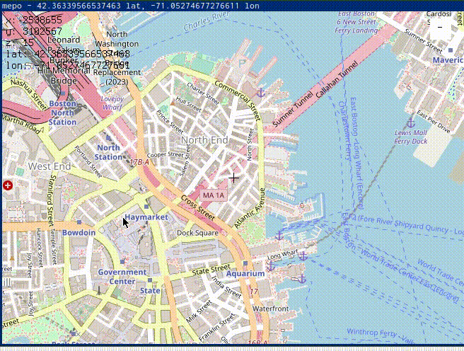

# **Mepo**

> **Note:** Mepo is currently in an alpha state although quickly making progress.
> An initial first tagged release (0.1), is scheduled to be released in short
> order (within less then a month or so). See below for the high-level goals,
> current state of Mepo, the path to 1.0, and information on contributing!

Mepo is a fast, simple, and hackable OSM map viewer for desktop linux
& mobile linux devices (like the Pinephone, Librem 5 etc.) and both
environment's various user interfaces (Wayland & X inclusive). Mepo
works both offline and online, features a minimalist both touch/mouse
and keyboard compatible interface, and offers a UNIX-philosophy inspired
underlying design, exposing a powerful command language called [mepolang](doc/mepolang.md)
capable of being scripted to provide things like custom bounding-box
search scripts, bookmarks, and more.

[Videos of User Interface](http://media.lrdu.org/mepo_demos)

## **Goals / overview of Mepo:**
- **Fast & usable in resource-constrained environments**:
  - Mepo **launches quickly and runs quickly** on the Pinephone and other
    resource-constrained devices. 
  - Mepo renders using SDL which keeps things **fast** and lightweight;
    also as a bonus: portable.
  - Built in a non GC'd language ([Zig](https://ziglang.org/)) with an aim toward careful
    memory usage and allocations/deallocations
- **UNIX-philosophy inspired design - scriptability via [mepolang](doc/mepolang.md)**:
  - Mepo's UI is built **to do one thing well**: download & render maps. 
    Extra functionality is enabled via its command language / API (mepolang).
  - Reduces overall application logic complexity, handing over to 
    shell-scripting integral features like map bounding-box & location search,
    bookmarks, dropping pins, rebinding keys, and more.
  - Existing OSM tools for search like the [Nominatim](https://nominatim.org/) & [Overpass](https://wiki.openstreetmap.org/wiki/Overpass_API) APIs are
    integrated through [bundled shell scripts](./scripts); customize to your heart's content
    or write your own scripts for things like bookmarking etc.
  - Bundled scripts utilize existing tools like [dmenu](https://tools.suckless.org/dmenu/)
    for user input and list selection rather then implementing application-specific input logic.
- **Offline operation as a first-class feature**:
  - Downloading of maps for later offline use can be done non-interactively
    through mepolang.
  - Users can download based on a bounding-box or a user-specified radius
    from a specific point for multiple zoom levels.
  - Offline usage is a primary usecase and should be treated as such, we 
    can't assume a user is always online.
- **Supports touch AND keyboard-oriented operation**:
  - A map application must ofcourse be usable with a mouse / touch, but
    the keyboard as a tool for map navigation has been underlooked in
    in map applications.
  - Provides vi-like (& customizable) keybindings out-of-the-box.
  - Should be usable in touch-oriented environments like the Pinephone and
    similar where a physical keyboard isn't present.

## **High-level overview of currently implemented features of Mepo:**
- Fast SDL-based rendering of OSM map tiles
- Downloading of OSM map tiles from user-specified source (default: OSM Maps)
- Minimal command-language for mepolang in which all core-functionality built out
- Pan via mouse, double tap to zoom, right click or triple left click to zoom out
- Vi-like keys (though customizable) for panning, zooming, center on mouse, etc.
- Navigate to regions or addresses via shell-script (Nominatim API based)
- Drop pins / search for POI via shell-script (Overpass API based)
- Cycle through pins using hotkeys (vim-like n/p, though customizable)
- Switch tile URL source via shell-script (toggle between OSM, Bike maps, Google)
- Dynamic tile caching to filesystem / offline-maps once downloaded
- Run API commands (mepolang) via command prompt (dmenu) or via STDIN (non-continual)

## **Roadmap to 1.0 release:**
- **Milestone 1: Overall Stability**
  - Current stability of the application should be improved and crashes should
    be non-existent.
  - Fix downloading bugs: make downloading tiles logic more robust, currently,
    tile downloading can occasionally / get stuck; implement retry logic.
  - Memory allocations / deallocations should be careful tracked and managed.
    Use arena allocator.
  - Rework blitting logic to be more intelligent about not drawing offscreen
    entities & pins.
  - Refactor error handling logic and implement log levels for debugging.
  - Tag 0.1 release upon completion
- **Milestone 2: Offline Mode & Noninteractive Downloading**
  - Add support for downloading tiles through mepolang download command.
  - Allow for both interactive (e.g. while running UI) and noninteractive (CLI)
    downloading of tiles.
  - Download command should allow downloading a coordinate with a given radius
    for specified zoom-level; Or a bounding-box for specified zoom-levels.
  - Add a shell script to download interactively based on Nominatim search
    query result so you can say download an entire city for example.
  - Create mepolang command to selectively clear download cache so
    tiles can be updated if outdated.
- **Milestone 3: Powerful, Robust Pin API**
  - Improve pin-selection mode:
    - Cycle currently active pin (with p/n keys) repositioning map to pin.
    - Ensure ability to cycle through pins only in viewport and all pins
      distinctly as two separate features.
  - Allow piping current state (lat/lon etc.) to scripts in shellpipe
    mepolang command, to feedback for viewport / bounding box search.
  - Add support for click pin to activate.
  - Implement command for removing specific pins.
  - Allow ability to associate metadata with pins
  - Fix existing pin bugs (e.g. title not showing properly & brittleness).
  - Add pin groups and extend API as such so user can distinguish groups;
    for example one pin group may be bookmarks, another for a search,
    another for current location.
  - Add script to add a pin based on Nominatim results in addition to
    existing Overpass pin script.
- **Milestone 4: Wayland & Mobile Support**
  - Add support for pinch-to-zoom using SDL multitouch gesture API, test
    on Pinephone & mobile devices.
  - Currently scripts for location search, bounding-box search,
    and similar use dmenu (X-based); integrate wofi or a similar tool
    for Wayland. XWayland can be used in intermediate term.
  - Ensure outside of desktop & Sxmo use there is a way we can bind mepolang
    commands to run. Within Sxmo, the context menu is the answer since a
    keybinding can launch a touch-friendly (dmenu) context menu. A context
    menu similarly could be implemented in Phosh and other environments
    using simple gesture detection (similar to lisgd).
  - Perform testing and make fixes as necessary for primary mobile UIs:
    Phosh, Sxmo, and Plasma Mobile.
- **Milestone 5: UI Niceties**
  - Use filedescriptor & poll/select or similar mechanism to read
    SDL events; add filedescriptor to continually monitor STDIN instead
    of config being one-shot. So commandline of running UI also can
    function as a mepolang debugging console.
  - Gracefully handle switching tile sources (e.g. purge cache & reload).
    Should be able to switch between OSM/bikemaps/stamen etc. without
    glitches.
  - Add per-tile-downloading progress-indicators.
  - Add bottom status bar to show current bandwidth usage / download of tiles.
  - Integrate gpsd into most likely a script to update user current location
    pin.
  - Finalize mepolang API and add error checking so things don't crash
    when accessing invalid union tag etc.
- **Milestone 6: Documentation & Packaging**
  - Add manpage documenting mepolang commands and basic usage.
  - Document examples on how to write custom scripts using mepolang.
  - Modify internals of mepolang to include documentation directly in
    structs so that mepolang API documentation can be automatically generated
    as a webpage for end-users.
  - Create Alpine/pmOS package and add to postmarketos-ui-* frontends.
  - Possibly package-split current `scripts/` directory to keep dependencies
    on base even more minimal.
  - Work with maintainers of mobile linux (& Pinephone) UIs to get
    Mepo integrated properly.
  - Tag 1.0 release

## **Contributing**

Mepo is surely welcome to contributors who have experience or interest
in mobile Linux, OSM, and/or Zig. Since things are still early on in the
project, there is no dedicated ML yet, however this will come soon. In
the meantime please either email me directly and I can provide guidance
on contributing or preferably drop into our IRC channel to discuss.

IRC Channel:
#mepo on irc.oftc.net

Contact email:
m at milesalan.com